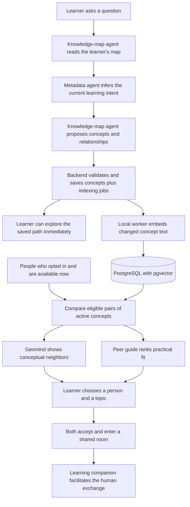

# Further v5 architecture

Two learners can describe the same problem differently. Further turns each question into a private concept map, finds people who are thinking about related concepts and available now, and opens a room when both people accept. Meta models interpret what the learners mean. PostgreSQL compares their concept vectors. The learners decide whether to connect.

## From a question to a conversation

On expansion, the map agent reads the owner's graph and delegates intent interpretation to the metadata specialist. It uses the returned interpretation to propose a path. The backend validates the proposal, records the model and run, and saves the graph. An ordinary expansion uses one metadata call and one map call. Further can also delegate peer discovery or a lesson through typed tools. Parent and child agents share an identity scope, deadline, cancellation signal and call budget. The UI streams persona-labelled tool activity and answer drafts while the run is in progress. [Agent protocol](agents/PROTOCOL.md) · [Runtime](../domains/agents/runtime.ts)

“My knowledge map” groups saved concepts across questions. The learner drills from a topic into subtopics and follows breadcrumbs back out. The owner-scoped summary keeps the underlying concept IDs, so changing a display group preserves the learning evidence and the concept used in discovery. [Hierarchy and semantic zoom](GEOMIND.md#topic-overview-and-semantic-zoom)

## What runs where

| Location | Components and responsibilities |
|---|---|
| Each developer's machine | The browser, Next.js API and six callable agent interfaces. A separate local Python process runs the pinned Meta encoder on CPU. |
| Meta Model API | Agent responses, image understanding, search grounding and speech transcription. |
| Baseten | Optional hosted Meta inference for the metadata agent. |
| Shared AWS development stack | Cognito identifies the learner. Aurora PostgreSQL Serverless stores learning records, index jobs, vectors and rooms through the RDS Data API. Private S3 stores uploaded images. |
| Isolated development mode | PGlite with pgvector, local accounts and private local image files support a single-machine workspace. |

The server derives the learner's identity at each protected route. Separate developer IAM credentials authorize the server to reach AWS. Model keys and AWS credentials stay server-side. [Onboarding](ONBOARDING.md) · [Data model and ownership](data/README.md)

## How Further uses Meta

| Capability | Model or method | Why it is used |
|---|---|---|
| Knowledge-map agent | Direct Meta `muse-spark-1.3` by default. The map model can be configured separately, including `muse-wonder-1.0`. | Translate a question into linked concepts, summarize saved topics or propose a next step. |
| Metadata agent | Direct Meta core model at low reasoning effort, or Baseten `meta-models/muse-spark-open-1026` when selected. | Produce structured, correctable intent and learning goals from the request. |
| Learning companion | Direct Meta core model, default `muse-spark-1.3`. | Teach a solo lesson, review an explain-back, or prompt two learners using their shared room conversation. |
| Resource guide and perception agent | Direct Meta core model, with web search or image input respectively. | Return provider-cited resources or propose a question about an uploaded image. |
| Voice input | Direct Meta `muse-voice-transcribe-1.0`. | Transcribe a spoken question before the learner submits it. |
| Semantic representation | Local `FacebookAI/roberta-base`. | Encode the meaning of a saved concept for numerical comparison. |
| Peer guide | Deterministic application code and pgvector. | Retrieve eligible people and explain which pair of concepts connects them. |

The team used Meta Muse Wonder alongside Codex during development. For product requests the app's own runtime orchestrates the specialists, and the OpenAI SDK carries requests to the configured Meta or Baseten endpoint. [Provider adapter](../domains/agents/openai-provider.ts) · [Meta model catalog](https://dev.meta.ai/docs/models) · [Baseten API](https://docs.baseten.co/reference/inference-api/chat-completions)

## How a new idea becomes a match

1. **Save the change.** When a learner adds a concept, the database transaction records their membership and queues its title and short explanation for indexing. A content hash skips unchanged text. Each learner can see indexing progress while continuing to use the saved map.
2. **Embed only changed text.** The local worker claims a batch and runs RoBERTa. It pools token representations, centers them using a fixed reference vector and normalizes the result. Each vector has 768 dimensions. Publication checks the source hash, job lease and encoder version. A superseded result cannot replace the latest one. Durable jobs resume when a local worker is available.
3. **Compare consenting, available learners at query time.** Geomind and peer recommendations share the same search. Eligibility includes adult confirmation, opt-in, fresh presence, language, at least ten minutes in common, and block and room checks. Exact pgvector search compares current, compatible vectors for active concepts. Private intent and inferred metadata have separate, owner-only indexes. A peer receives only the permitted topic pair and fit information.
4. **Show what connects the pair.** Similarity is `1 − cosine_distance(a, b)`. Different titles and IDs can match without a shared keyword. Geomind places closer semantic neighbors nearer the viewer and shows the two topic titles. Recommendations combine 85% best-pair similarity, 10% explanation evidence and 5% available-time fit. Missing vectors produce an indexing or unavailable state. Opening Geomind or pressing Refresh queries the current neighborhood. Choosing a peer triggers another eligibility check.

The encoder and thresholds are experimental. A cosine score orders candidates. Learning evidence describes prior activity or feedback on an answer. Population-scale retrieval and improved learning outcomes still need pilot measurements. [Search implementation](../domains/backend/social.ts) · [Ranking formula](../lib/matching.ts) · [Encoder and evaluation](retrieval/README.md) · [Geomind rules](GEOMIND.md)

For a route-by-route view and executable checks, see the [dependency map](CODE_MAP.md).
