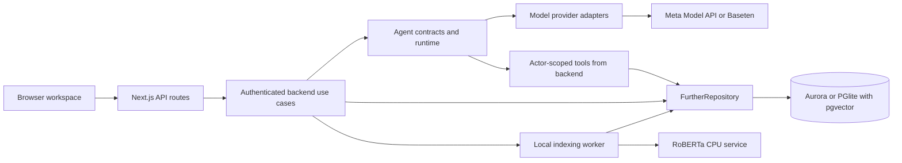

# Further v5 dependency map

Start from the interaction a learner sees. Follow the route into the backend, then into the agent, database record or vector calculation that produces the result. [System architecture](ARCHITECTURE.md) · [Run locally](ONBOARDING.md)

## Runtime dependencies

This diagram follows runtime calls. The generated inventory records static imports among 158 TypeScript files, including type-only imports. It contains 496 local import edges and per-domain totals. Run `npm run map` after a source change. The Python encoder and remote APIs appear in the runtime diagram because the TypeScript import graph cannot capture HTTP calls. [Machine-readable import inventory](dependency-map.json) · [Generator](../scripts/dependency-map.mjs)

## Follow a learner action through the code

| Learner action | Server entry and implementation | Record or decision | Focused checks |
|---|---|---|---|
| Sign in and become available | `/api/auth/*`, `/api/data/profile`, `/api/local/presence` → [identity](../domains/backend/identity.ts) and [repository](../domains/data/repository.ts) | Verified account, learner opt-in, language, available time, heartbeat | [Cognito](../tests/cognito-auth.test.ts) |
| Ask a question or go deeper | `/api/expand` → [expand route](../app/api/expand/route.ts) → [agent invocation](../domains/backend/agents.ts) → [runtime](../domains/agents/runtime.ts) | A saved question, canonical concepts and edges, private map membership, inferred metadata, run provenance and index jobs | [Missions](../tests/backend-missions.test.ts) · [Streaming](../tests/agents-streaming.test.ts) |
| Open My knowledge map and drill in | `/api/knowledge/overview` → [overview](../domains/backend/knowledge-overview.ts) → [hierarchy](../lib/knowledge-hierarchy.ts) | Private derived summaries group existing concept IDs across questions | [Overview](../tests/knowledge-overview.test.ts) |
| Wait until a new concept is searchable | [Indexing worker](../domains/retrieval/client.ts) → [Python encoder](../domains/retrieval/embedding_service.py) → [repository](../domains/data/repository.ts) | A leased job publishes a source-current, versioned `vector(768)` | [Incremental indexing](../tests/semantic-indexing.test.ts) |
| Open Geomind or request a peer | `/api/geomind` or `/api/match` → [shared retrieval](../domains/backend/social.ts) → [fit policy](../lib/matching.ts) → [neighborhood](../domains/backend/geomind.ts) | Eligible active concept pairs ranked with exact cosine. Geomind displays semantic distance. Peer recommendations add evidence and time fit. | [Semantic matching](../tests/semantic-matching.test.ts) · [Geomind HTTP](../tests/geomind-http.test.ts) |
| Select a neighbor and accept an invitation | `/api/geomind/invite`, `/api/match`, `/api/inbox` → [social](../domains/backend/social.ts) and [repository](../domains/data/repository.ts) | Rechecked eligibility, both concept IDs, invitation and room membership | [Backend HTTP](../tests/backend-http.test.ts) |
| Exchange messages and explain a concept | `/api/session/{id}/message`, `/api/explain` → [facilitation and explain-back contracts](agents/PROTOCOL.md) | Room messages feed shared facilitation. A personal explain-back records feedback on the learner's own answer. | [Agent evidence](../tests/agents-evidence.test.ts) |

Resource lookup, image intake and speech use `/api/card/{slug}`, `/api/media/understand` and `/api/transcribe`. The [provider adapter](../domains/agents/openai-provider.ts) defines model routing, the [media store](../domains/backend/media-storage.ts) enforces image ownership, and [audio tests](../tests/agents-audio.test.ts) cover transcription.

## Schema and storage entry points

| Migration | Responsibility |
|---|---|
| [001](../domains/data/migrations/001_local.sql) | Concepts and edges, learner membership, learning events, metadata, presence, invitations, rooms, agent runs, media references and 768-dimensional vectors |
| [002](../domains/data/migrations/002_accounts.sql) | Accounts, usernames, provider subjects, sessions and OAuth state |
| [003](../domains/data/migrations/003_semantic.sql) | Durable indexing jobs, generation leases and retry state |
| [004](../domains/data/migrations/004_cognito.sql) | Cognito identities |
| [005](../domains/data/migrations/005_learning_map_reset.sql) | Owner-scoped learning-map reset receipts |
| [006](../domains/data/migrations/006_explanation_counts.sql) | Explanation-event index for anonymous completion counts |

Both database modes use the same repository contract. The SQL adapter selects Aurora through the RDS Data API or local PGlite. [Contract](../domains/data/contracts.ts) · [SQL adapter](../domains/data/sql.ts) · [Data model and ER diagram](data/README.md)

## Agent and stream contracts

`GET /api/agents` exposes six agent cards with typed input and output schemas. A caller can invoke one through `POST /api/agents/{agentId}`. The backend supplies the actor from the verified session. A delegated specialist shares the parent's cancellation, correlation and budget. Retry keys allow the backend to recover saved results.

An SSE client receives `activity` (who is working and what action is in progress), `text_delta` (provisional public text), then a validated `result` or a safe `error`. The browser uses the same agent ID for the persona label. The running app exposes its agent registry and configuration at `/architecture`. [Agent schemas](../domains/agents/contracts.ts) · [Stream producer](../domains/backend/streaming.ts) · [Agent protocol](agents/PROTOCOL.md)
